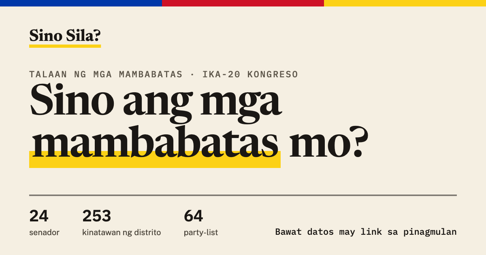

# Sino Sila?

**Who are your lawmakers?** A free, open record of the Philippines' senators and House representatives: the bills they
file, the laws they pass, their court cases, their declared wealth, how they were elected and where they studied.
Every fact links to its public source.

**Live site: https://sinu-sila.com** · English and Filipino · works on any phone



## What's on the site

- **Find your lawmakers.** Search a name, province, city or party, or pick where you live to see your district
  representative and all 24 senators.
- **Senate** (24 senators): bills authored per month and where they stand, laws passed with each senator's role,
  education, SALN (declared assets, liabilities and net worth), the 2025 or 2022 election result, and court cases.
- **House of Representatives** (253 district representatives and 64 party-list representatives): grouped by province,
  with party, bloc, 2025 election result and court cases.
- **Court cases, handled carefully.** A case needs two independent sources or an official court record. A charge is
  shown as an allegation unless a court decided it, and "not yet checked" is never presented as a clean record.
- **Updated weekly**: Senate bills and laws, the House roster and SALN totals refresh every Monday.

## Principles

1. **No record without a source.** `validate.py` refuses data without a source link.
2. **Facts, not verdicts.** Neutral wording, presumption of innocence, dismissals and acquittals listed alongside charges.
3. **Open data first.** Where [BetterGov.ph](https://bettergov.ph) already publishes clean open data (SALN, election
   results), we build on it and credit it.
4. **Private by design.** No trackers, no cookies, no ads. The visit counter keeps daily totals only.
5. **Corrections welcome.** Every page has a "Report an error" button, and officials can reply to any data point.

## Run it locally

No build step and no dependencies: one HTML file plus JSON data.

```bash
git clone https://github.com/lslaoang/ph-politicians.git
cd ph-politicians
python3 -m http.server 8000      # then open http://localhost:8000
python3 validate.py              # checks every record has a valid source
```

## Repository layout

```
index.html            the whole site (HTML, CSS and JavaScript in one file)
stats.html            private visit dashboard (key-protected, not linked)
data/                 JSON data, one file per topic (see docs/data.md)
assets/photos/        portraits (Wikimedia Commons, credited on each profile)
assets/schools/       school seals (identification only)
tools/                importers, the weekly update runbook and the two small AWS Lambda functions
docs/                 data sources and methods, operations
validate.py           data checks, run before every publish
```

## Data sources

| Data | Source |
|---|---|
| Senators, bills, laws | [Senate of the Philippines](https://senate.gov.ph), Legislative Information System |
| House roster | Wikipedia's list of current members (each record cites the exact revision) |
| SALN | [BetterGov.ph SALN Tracker](https://github.com/bettergovph/saln-tracker-ph) |
| Election results | [BetterGov.ph Dynasties](https://dynasties.bettergov.ph), built from [Open Halalan](https://robertrleung.github.io/OpenHalalan/) |
| Court cases | News outlets and court or Ombudsman records, linked per event |
| Education | Senate profiles, Wikipedia, cross-checked against news and fact-check outlets |
| Political families | Links to [Pulitiklan](https://pulitiklan.com) |
| Portraits | Wikimedia Commons |

Methods, coverage and known gaps: **[docs/data.md](docs/data.md)**. Hosting, deploys and automation:
**[docs/operations.md](docs/operations.md)**.

## Contributing

Corrections, new sources, translations and code are all welcome. Read **[CONTRIBUTING.md](CONTRIBUTING.md)** first;
the rules for court cases are strict on purpose. To report a factual error, use the "Report an error" button on the
page or [open a correction issue](https://github.com/lslaoang/ph-politicians/issues/new?template=correction.yml).

## License

Code: [MIT](LICENSE). Data and images keep the terms of their sources; see **[DATA_LICENSE.md](DATA_LICENSE.md)**
(our compilations are CC BY 4.0, the House roster is CC BY-SA 4.0 because it comes from Wikipedia, election data is
CC0, school seals are not licensed for reuse).

## Disclaimer

Sino Sila? is an independent project, not affiliated with the Senate, the House of Representatives, COMELEC or any
party. The data is compiled with care from public sources but may contain errors or be out of date. A court case listed
here is a public record, not a finding of guilt.
